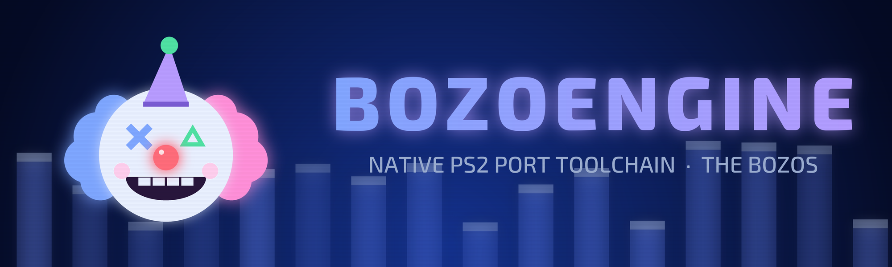

# BozoEngine

The Bozos' own toolchain for native PC ports of PlayStation 2 games: a static recompiler for the game's EE code, and a
runtime that answers the game's calls with native PC code. **No PS2 hardware at any level**: no GS, no VU, no VIF/GIF,
no DMA controller, no IOP, no SPU2. What the game draws goes to a native renderer; what it plays goes to a native
mixer; what it reads, saves and polls comes from native implementations of the libraries it calls.

Status: **Twisted Metal: Black runs on it**, in a window (SDL3, OpenGL 3.3) at 60 fps, with pads for 1 to 4 players
and sound, from the boot through the menus, matches and the story. Its menus and settings panel are being finished;
the release moves to BozoEngine once the comparison with the current build is clean. See [docs/PLAN.md](docs/PLAN.md).

## Why

- **Own it.** Code written by The Bozos, MIT-licensed, nothing copied from other projects (see "Clean room" in the
  plan).
- **Native by construction.** There are no emulation layers to route around: the runtime implements Sony's libraries
  at the call the game makes (read the pad, open a file, play a movie), not the chips below them.
- **Proved against what works.** Every step is checked against recordings of the current build: the same game state,
  calls, threads and draw lists, frame by frame (boot and a full match, 74 million recorded calls, 0 differences).

## Layout

| Folder | What |
|---|---|
| `recompiler/` | `bozo-recomp`: ELF loader, function discovery, R5900 (EE) to C++ translation |
| `runtime/ee/` | The EE kernel (threads, semaphores, interrupt handlers) and the dispatcher |
| `runtime/libs/` | Native Sony libraries: libc/libm, pad (multitap), memory card, CD/DVD, libmpeg (FFmpeg), GS library, VU0 programs, SIF, the 989SND sound driver |
| `runtime/render/`, `runtime/audio/` | The native renderer (OpenGL 3.3) and mixer |
| `runtime/app/`, `runtime/host/`, `runtime/port/` | Window, input and settings (SDL3); the real-time host; the API a port's own code uses |
| `tools/` | The checkers (`run`, `replay`), the pack writers (`native_pack`), `externals`, capture and IRX readers, `branding` |
| `tests/` | Instruction, library, audio and runtime tests |
| `reference/` | Hashes of the reference runs the checks compare against (no game data) |
| `docs/` | The plan, the specs the code is written from, the branding |

`tools/branding/make_logo.py` makes The Bozos' logos for any port: `python make_logo.py port <name> "<TITLE>"
"<SUBTITLE>" [fire]` (`--help`).

## Licence

MIT, see [LICENSE](LICENSE). Game data is never part of this repository: every port builds from the player's own disc.

By The Bozos (boubou666 and Arzaroth).
